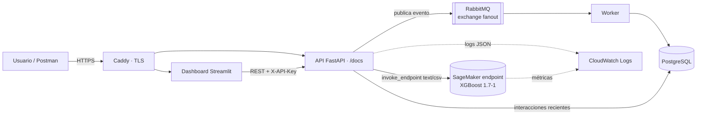

# ShopFast · Sistema de recomendación con IA en AWS

Proyecto semestral de **ITY1102 Arquitectura de Sistemas de IA** (Duoc UC), Equipo 4:
Diego Hernández, Samuel Canchaya y Sebastián Escobar.

Recomienda productos a los clientes de un e-commerce de electrónica estimando la **probabilidad de compra**
de cada par cliente–producto con **XGBoost desplegado en Amazon SageMaker AI**, y explica cada recomendación
para que el área comercial decida a quién ofrecer qué.



## Modelo
| | |
|---|---|
| Dataset | [eCommerce events history in electronics store](https://www.kaggle.com/datasets/mkechinov/ecommerce-events-history-in-electronics-store): 885.129 eventos (vista, carro, compra), 407.283 usuarios, 53.453 productos, sep-2020 a feb-2021 |
| Unidad | Par (usuario, producto) con al menos una vista o carro → ¿lo compra? (556.037 pares, 4,4% positivos) |
| Características | 18: comportamiento del par, del producto y del cliente (`data/processed/feature_names.json`) |
| Partición | Temporal: entrenamiento hasta dic-2020, validación ene-2021, prueba feb-2021 |
| Algoritmo | XGBoost `binary:logistic`, max_depth 6, eta 0,1, subsample 0,8, scale_pos_weight 5, early stopping 25 |

Resultados en el conjunto de prueba (febrero 2021, umbral 0,52 elegido en validación):

| Accuracy | Precision | Recall | F1 | ROC-AUC | PR-AUC | Hit@1 (ranking) |
|---|---|---|---|---|---|---|
| 0,953 | 0,499 | 0,884 | 0,638 | 0,969 | 0,576 | 89,5% (azar: 41,2%) |

## API REST (Swagger en `/docs`)
| Método | Ruta | Descripción |
|---|---|---|
| GET | `/health` | Estado y backend del modelo (público) |
| GET | `/v1/recommendations/{user_id}?n=10` | Top-N con probabilidad, decisión y 3 motivos (SHAP) |
| POST | `/v1/predict` | Probabilidad de compra de un par cliente–producto |
| POST | `/v1/interactions` | Registra vista/carro/compra → RabbitMQ (202) |
| GET | `/v1/model` | Métricas del modelo |
| GET | `/v1/stats` | Interacciones procesadas por el worker |

Autenticación con cabecera `X-API-Key`, límite de solicitudes por llave (`RATE_LIMIT`) y TLS en Caddy.

```bash
curl -H "X-API-Key: <llave>" "https://api.<DOMAIN>/v1/recommendations/1515915625532264305?n=5"
```

## Ejecutar localmente
```bash
pip install -r requirements-ml.txt
cp /ruta/events.csv data/raw/ && make data && make train-local
cp .env.example .env            # PREDICTOR=local
make up                         # https://localhost (dashboard) · https://api.localhost/docs
make test                       # 23 casos de prueba
```

## Desplegar en AWS
Ver [`deploy/DEPLOY.md`](deploy/DEPLOY.md): SageMaker (training job + endpoint serverless o real-time con auto scaling)
y un EC2 con Docker Compose, pensado para AWS Academy Learner Lab.

## Estructura
```
api/          FastAPI: features, predictor (SageMaker/local), explicaciones SHAP, seguridad
worker/       Consumidor RabbitMQ → PostgreSQL (idempotente, DLQ)
dashboard/    Streamlit (consume solo la API)
ml/           Preparación de datos y entrenamiento/evaluación local
sagemaker/    Entrenamiento, despliegue, auto scaling, evaluación y limpieza con boto3
tests/        23 casos (unitarias + integración + contrato OpenAPI)
loadtest/     Locust
deploy/       Guía Learner Lab, Caddyfile, user data del EC2, esquema SQL
```
